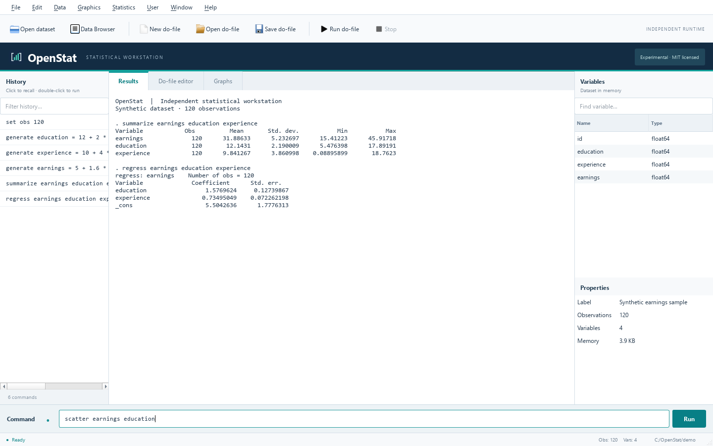

<p align="center"></p>

An independent, MIT-licensed statistical workstation with a Stata-style command interface, do-file editor, data browser, graphs, and an experimental Python runtime.

**OpenStat 0.1 is a working prototype, not a drop-in replacement for Stata. It cannot run arbitrary Stata do-files, the full Mata language, or arbitrary SSC packages.** Unsupported commands and options report errors. Passing the included examples establishes only those examples. See the [compatibility contract](docs/compatibility.md), [feature target inventory](docs/feature-inventory.md), and [REA investigation](docs/inspection.md).



## Install and launch

Python 3.11–3.13 recommended. Windows was tested locally; Linux and macOS remain unverified. No Stata installation or license is required to run OpenStat.

```powershell
git clone https://github.com/dgonzalezgonzalez/OpenStat.git
cd OpenStat
python -m venv .venv
.venv\Scripts\python -m pip install ".[desktop]"
.venv\Scripts\python -m openstat
```

Windows users can then double-click `OpenStat.cmd`. On macOS/Linux, use `.venv/bin/python` instead. For development, install `-e ".[desktop,test]"`. Qt Essentials supplies the desktop; headless installations need only `pip install .`.

Run a do-file without the GUI:

```sh
python -m openstat --batch examples/quickstart.do --json result.json
```

Batch runs use the current directory unless `--cwd DIRECTORY` is supplied. A script failure stops execution, produces a Stata-style return code and source line, and sets a nonzero process exit status. JSON contains the full runtime return code. Commands already completed before an error retain their changes.

## What works

- Native desktop: Results, command entry/history, do-file syntax highlighting, line numbers, find, open/save, run selection, variables/properties, editable Data Browser, graph previews, and keyboard shortcuts. Background execution is serialized; Stop interrupts at statement boundaries.
- A bounded do-file language: comments, continuations, delimiters, compound quotes, local/global macros with extended expansion, `forvalues`/`foreach`/`while`/`if`/`else` with `continue`/`break`/`exit`, programs with positional `args`, `syntax`, `marksample`/`mark`/`markout`, `tempvar`/`tempname`/`tempfile`, stored `r()`/`e()` results, `capture`, `quietly`, `noisily`, `if`/`in`, variable wildcards and ranges, and factor-variable specifications (`i.`, `c.`, `##`).
- Data generation, filtering, sorting, grouped calculations, summaries, CSV/Excel import/export, append, validated merges, numeric long/wide reshape, collapse, preserve/restore, labels, encode/decode, duplicates, and strict numeric/string conversions.
- **Stata's numeric display formats.** `%w.dg`, `%w.df`, `%w.de` and `%w.dgc` reproduce Stata 19.5 byte-for-byte on a 385 815-measurement corpus plus 7 160 targeted probes, and `describe` reproduces Stata's layout byte-for-byte. The model is documented in [docs/formats.md](docs/formats.md).
- **Stata's storage types.** `byte`, `int`, `long`, `float` and `double` keep Stata's ranges, Stata's default display format per type, and Stata's rule that an out-of-range integer becomes *missing* rather than clamped. `generate` creates a `float` variable unless a type is named, exactly as Stata does.
- **Stata's `r()`, `e()` and `c()`.** The expansion in macro position, the rendering in expression position, and the behaviour of an unknown name all follow Stata 19.5.
- **Stata's random numbers.** The generator is Stata's MT64 variant with the ziggurat normal, verified draw-for-draw against Stata 19.5. See [docs/random-numbers.md](docs/random-numbers.md).
- Reading supported DTA variants through ReadStat; writing 114/117/118/119 through pandas. The live conformance suite tests **DTA118 numeric/string data and labels**, not every DTA feature. Extended missing values are rejected when loading instead of silently collapsed.
- OLS, HDFE (`reghdfe`-style absorbed effects with `e(df_a)` semantics), `areg`/`xtreg`, 2SLS, binary logit/probit, Poisson, predictions, weights, HC1/cluster covariance, basic hypothesis/mean tests, `esttab`/`estout` tables, and matrix arithmetic through maintained numerical libraries. OLS, robust/clustered covariance, HDFE, 2SLS and stored logistic results have bounded Stata comparisons; other models need broader validation.
- A small interpreted Mata subset: real numeric matrices, assignment, transpose, matrix multiplication, loops and user functions, selected algebra functions, `st_matrix()` and `st_numscalar()`; no compiled Mata, classes, pointers, views, or `.mlib` execution.
- SSC and `net install` descriptor/file downloads, isolated package directory, manifests with hashes, and autoloading of compatible ado programs. Downloading a package does **not** prove it can execute. Most substantial community packages need syntax and primitives that are still missing.

## Quick example

```stata
clear all
set obs 12
generate x = _n
generate z = mod(_n,3)
generate y = 1 + 2*x + .5*z + mod(_n,2)
regress y x z
display _b[x]
scatter y x
graph export "example.png", replace width(900)
```

The GUI uses an original OpenStat visual identity while retaining the observed statistical-workstation arrangement. It does not copy Stata's icons, graphics, executable, sources, dialogs, or branding.

## Verification

```sh
python -m pip install ".[desktop,test]"
python -m pytest -q

# differential against an installed Stata 19.5
python qa/conformance_run.py --all --diff
python qa/replication_run.py --list
python qa/gap_report.py            # roll every suite into one ranked queue
```

Current measured state: **252 passed, 4 skipped** in `pytest -q`, **10/10**
conformance cases, **20 of 21** differential cases (the SSC download case is
opt-in), and **2/2** published replication packages on this host. Replication
also records wall time, and OpenStat is much slower than Stata on
`dropout_jpe_descriptives` (about 145 s against 1.6 s) — that is a recorded
performance gap, not a correctness claim. `qa/gap_report.py` writes
`qa/gap-report.md`. The desktop gap list is [measured separately](docs/ui-parity.md).

The conformance harness runs the same `qa/conformance/cNN_*.do` in Stata and
in OpenStat, each in its own temporary directory, and compares the sentinel
values and return codes. The replication harness runs real published
replication packages (AEA, JPE) end to end. Neither touches personal
do-files or existing Stata sessions.

The older checked-in differential runner is still available:

```sh
python qa/run_differential.py --stata "C:/Program Files/StataNow19/StataMP-64.exe"
python qa/run_differential.py --online-ssc --case ssc
```

It generates temporary synthetic inputs, starts its own licensed Stata child
with a maximum 30-second case timeout, and compares scalars, exported CSVs,
DTA labels and PNG dimensions. Network testing is opt-in.
[Checked-in results](qa/report.json) identify the tested cases, hashes,
tolerances, timings, return codes, and reference version.
[Stored reference values](qa/stata_reference.json) allow tests without
Stata.

**Reference boundary:** the installed oracle is **StataNow/SE 19.5**
(`/Applications/StataNow` on macOS, `C:\Program Files\StataNow19` on the
Windows host used for the current measurements); older shipped help/resources
describe an earlier snapshot. The official update page listed revision
**14 October 2026** at inspection; that revision was not installed or tested.
REA provided static evidence from the shipped binary — the display-format
model, the macro-expansion format, the RNG constants and the storage-type
defaults — recorded in the [inspection record](docs/inspection.md). No
exhaustive understanding or latest-version equivalence is claimed.

## Development priorities

1. Formal grammar, macro scopes, strings, missing values, storage types, and adversarial semantic tests.
2. Ado `syntax`/parsing primitives and package dependency discovery, tested package by package.
3. Matrix/Mata language and numerical conformance; extended DTA metadata/long-string coverage.
4. Statistical families, postestimation, factor/time-series operators, weights, panel/survey/MI/Bayesian workflows.
5. Native installers, cross-platform UI checks, richer graphs/reporting, and bounded conformance corpora.

Contributions should include a short synthetic reproducer, precise expected behavior, source/provenance, and numerical tolerances. Proprietary Stata sources and user datasets do not belong in this repository. See [CONTRIBUTING.md](CONTRIBUTING.md).

## License and provenance

OpenStat's original code, documentation and logo are [MIT licensed](LICENSE). Dependencies and downloaded third-party packages keep their own licenses; see [THIRD_PARTY.md](THIRD_PARTY.md). Stata and Mata are trademarks of StataCorp LLC. OpenStat is independent and is not affiliated with or endorsed by StataCorp.
